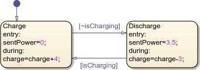

# Objective

Build and test a finite state machine (FSM) in Simulink using Stateflow.
Define inputs, outputs, guards, and actions.
Compare level-triggered counting with rising-edge counting.

# Theoretical aspects

This lab requires MATLAB, Simulink, and Stateflow. **Simulink** connects source
blocks, processing blocks, and output displays. A **Stateflow Chart** implements
discrete control logic; a **Scope** shows signal histories and a **Display** shows
current values.

The main chart elements are:

- **States:** operating conditions; the **default transition** (an arrow with no
  source state) selects the initial state.
- **Transitions:** connect states. In `[condition] / action`, the Boolean
  **guard** controls whether the transition can be taken; the action runs when it is taken.
- **State actions:** `entry:` runs when a state is entered; `during:` runs when
  it remains active and no outgoing transition is taken.
- **Chart data:** has scope **Input**, **Output**, or **Local**. Use `boolean`
  for logical signals and `int32` for the counter.

Use the **MATLAB action language**: `==` compares, `&&` means AND, `~` means NOT,
and `=` assigns a value.

{width=65%}

In this example, the default arrow selects `Charge`; the guards use `isCharging`
to select the mode. Both states contain `entry:` and `during:` actions.
Source: [MathWorks, Create Stateflow Charts](https://www.mathworks.com/help/stateflow/gs/get-started-create-chart.html).

With sample time $T_s = 0.1\,\mathrm{s}$, inputs are evaluated every 0.1 seconds.
A TRUE **level** can cause repeated counting; a **rising edge** occurs only when
the previous sampled value was FALSE and the current value is TRUE. Edge detection
therefore requires remembering the previous value.
See also the [Stateflow chart documentation](https://www.mathworks.com/help/stateflow/ref/chart.html).

# Exercises

## 1. Create a parking counter

Create a blank Simulink model and add a Stateflow **Chart**. Define Boolean
inputs `up` and `down` for entering and leaving cars, and an `int32` output
`count` for occupancy (0 to 10 inclusive).

Implement these requirements:

- Initialize `count` to 0 at simulation start.
- On each subsequent execution, increment once if only `up` is TRUE;
  decrement once if only `down` is TRUE.
- If both inputs are FALSE or both are TRUE, keep the count unchanged.
- Ignore requests to increment above 10 or decrement below 0.
- Keep the output defined even when no count-changing transition occurs.

**Design hint:** use states `Empty`, `Cars1`, ..., `Full`, assigning the
corresponding output on entry. Design the guards yourself.

Connect two **Constant** blocks with output type `boolean` to the inputs,
a **Display** to `count`, and all three signals to a **Scope** with multiple input
ports. Start both inputs at FALSE. Test using **Step** blocks or change the
constants during a paced simulation. Save this version before extending it.

## 2. Count rising edges instead of levels

Extend the model as follows:

- Count each FALSE-to-TRUE change only once, even if the input stays TRUE.
  Insert [Detect Rise Positive](https://www.mathworks.com/help/simulink/slref/detectrisepositive.html)
  blocks between the sources and the chart. Apply Exercise 1's counting rules
  to their edge indicators; simultaneous rising edges cancel.
- Add input `count_init` (`int32`, values 0 to 10), supplied by a Constant block.
  Read it once at simulation start; restart the simulation to apply a new initial count.
- Start `up` and `down` at FALSE; do not count during initialization.

**Test checklist**

- Verify initialization with counts 0 and 4.
- Test one entry, one exit, and two entries separated by FALSE.
- Test simultaneous rising edges and requests at counts 0 and 10.
- From an interior count, hold only `up` TRUE for 0.5 seconds: expect repeated
  increments in Exercise 1 (up to capacity), but only one in Exercise 2.

# General requirements

- **Model Settings:** solver type **Fixed-step**, solver **discrete (no continuous
  states)**, fixed-step size **0.1 seconds**.
- **Chart and sources:** chart update method **Discrete**; chart and input source
  sample times **0.1**, so edge detectors inherit the same rate.
- **Output retention:** clear **Initialize outputs every time chart wakes up**
  in the chart properties if enabled; entry-assigned outputs must retain their values.

Hints:

- Simulate for at least 10 seconds.
- Use **Simulation Pacing** for interactive changes.
- Put both inputs and the output on a **Scope** to see the results.
- Save a screenshot of the Scope after each test.

# Final questions

1. Why does holding `up` TRUE produce different results in the two versions?
2. Can the chart detect a pulse entirely between two sample times?
   Would rising-edge detection alone solve this problem?
