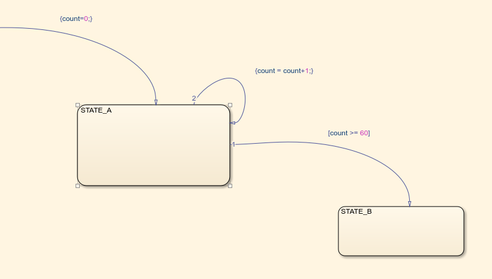
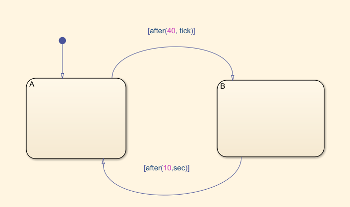
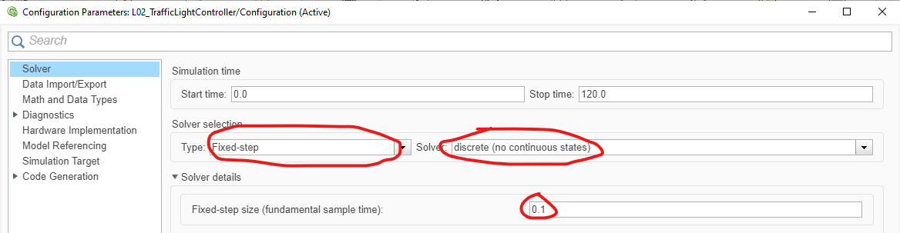
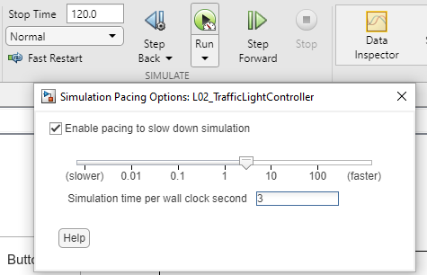
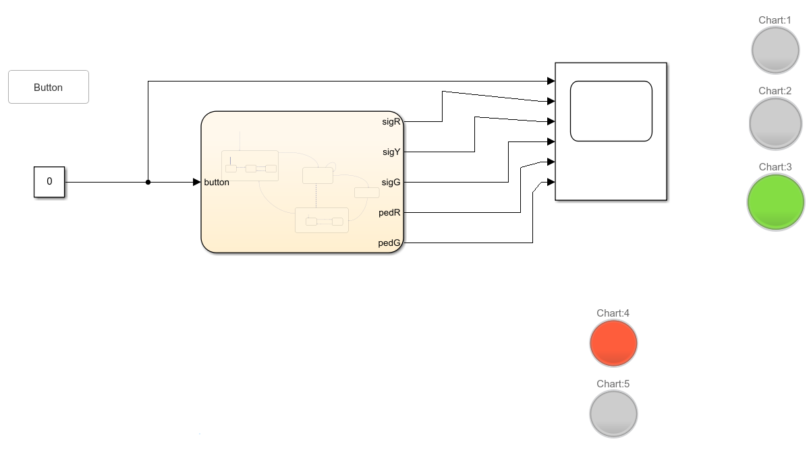

# Objective

Design and test a timed Stateflow traffic light controller with pedestrian
requests and blinking signals, visualizing the inputs and the outputs.

# Theoretical aspects

Time in a discrete chart advances in simulation steps.
For example, if the sample time is $T_s = 0.1\,\mathrm{s}$,
ten steps correspond to one second.

Two ways to measure time are:

1. **Counter variable:** initialize a local counter when timing starts, increment
   it once per chart execution, and compare it with a threshold. Convert a desired
   duration $T$ into a number of steps using $N = T/T_s$ when the ratio is an
   integer. Check the order of incrementing and testing to avoid a one-step error.

   {width=65%}

2. **Temporal operator:** use a condition such as `[after(5,sec)]` to test elapsed
   time since the associated state became active. The timing restarts on re-entry
   to that state; a transition can occur only when the chart executes.

   {width=60%}

The operator's time units have different meanings:

- `sec`: seconds, e.g. `[after(5,sec)]`.
- `msec`: milliseconds, e.g. `[after(250,msec)]`.
- `tick`: time steps elapsed in the current state, e.g. `[after(30,tick)]`.
  For this periodic chart, tick-based delays depend on the sample time.

More details: [MathWorks, after](https://www.mathworks.com/help/stateflow/ref/after.html).

# Exercises

## 1. Car traffic light controller

Create a Simulink model containing a Stateflow chart modeling a traffic light controller for cars, with a pedestrian crossing request.
Use the following list of Boolean input and output signals.
For outputs, TRUE turns a light on, FALSE turns it off.

| Signal | Scope | Meaning |
|---|---|---|
| `button` | Input | Pedestrian crossing request; TRUE while pressed |
| `sigR` | Output | Car red light |
| `sigY` | Output | Car yellow light |
| `sigG` | Output | Car green light |

Implement these requirements:

- Initialize the controller to red. Red lasts 30 seconds and is followed by green.
- Green lasts at least 60 seconds. With no pedestrian request, it remains green
  indefinitely.
- A request **during** the first 60 seconds of green causes yellow only when those
  60 seconds expire, even if the button has already been released in the meantime.
- A request **after** the first 60 seconds of green causes yellow as soon as possible, without an additional waiting period.
- Yellow lasts 5 seconds and is followed by red.

**Design hint:** consider what information must be retained after the button is
released, and when to clear it.

Keep car lights mutually exclusive at every time (only one light on at any time).

Use a Scope to visualize the input and outputs, and check that the timing requirements are met.

## 2. Extensions

Save the basic controller designed at Exercise 1, and then extend it with the following features:

- Add Boolean outputs `pedR` and `pedG` for pedestrians. Pedestrian have red while
  cars have green or yellow; pedestrian have green while cars have red.
  Never allow pedestrian green together with car green or yellow.
- Make car yellow blink: 1 second on, 1 second off. Keep the total yellow phase
  at 5 seconds, including its off intervals.
- Make pedestrian green blink during its final 8 seconds, without changing the
- total duration of 30 seconds.

**Design hint:** blinking must not restart the timer for the overall traffic phase.

# General requirements

- **Timing:** In Model Settings,choose solver type **Fixed-step**, solver **discrete (no continuous states)**,
  and fixed-step size **0.1 seconds**.
  <!-- Set the chart's update method to **Discrete** and sample time to **0.1**. -->
<!-- - **Outputs:** assign all light outputs explicitly when phases change. If outputs
  are assigned only on state entry, clear **Initialize outputs every time chart
  wakes up** in the chart properties if enabled. -->
- **Simulation:** run for at least 120 seconds per test; extend the stop time as
  needed. Use **Simulation Pacing** at 3–4 times normal speed for interactive tests.
  Pacing changes the viewing speed, not the specified simulation-time durations.

  {width=65%}

  {width=60%}

- Put the input and all outputs on a **Scope**, for visualization.

- For interactive testing, use a **Push Button** block from the Dashboard library and a **Lamp** block for each light output. T

  - Connect a Boolean Constant block to `button` and bind a Dashboard **Push Button**
to that block's value (FALSE when released, TRUE when pressed).

  - Bind three Dashboard **Lamp** blocks to the three car outputs. Add two lamps for the extension with pedestrian outputs.

  {width=85%}

# Testing the design

Use separate runs and verify:

- Initialization, red duration, and green continuing beyond 60 seconds without a request.
- A brief request early in green, released before the minimum green time expires.
- A late request, followed by yellow and red; then another cycle to check that
  a serviced request does not remain pending.
- Both blinking extensions, their overall phase durations, and mutually exclusive lights.

Use Scope timestamps to measure durations rather than wall-clock time.
Save the models, and also representative Scope screenshots illustrating the steps.

# Final questions

1. If the sample time changes from 0.1 to 0.2 seconds, what must change in a
   counter-based timer? What changes when using `after(...,sec)` or `after(...,tick)`?
2. Why must the controller remember a request after the button is released?
   When should that request stop affecting subsequent cycles?
