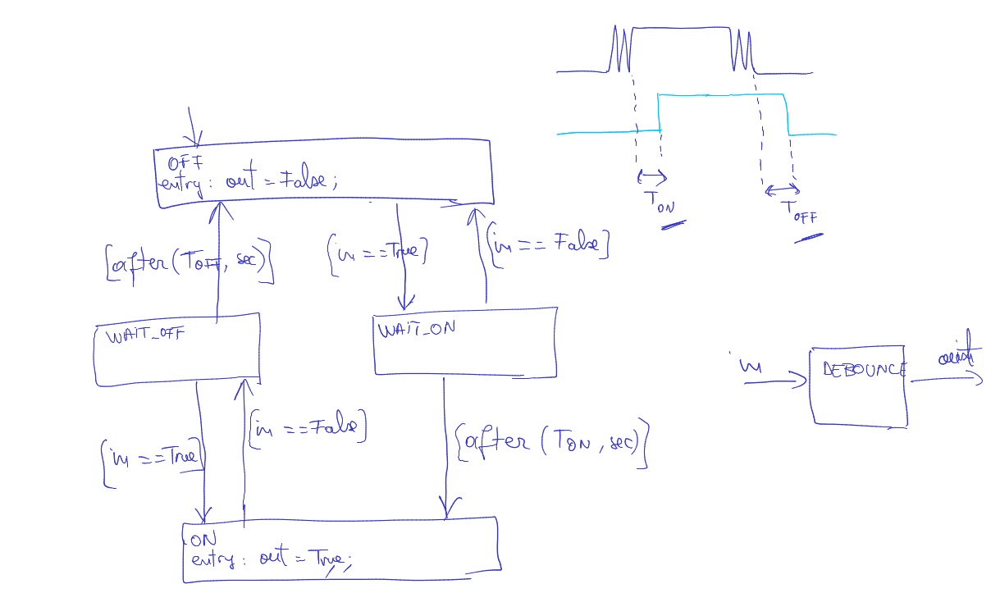
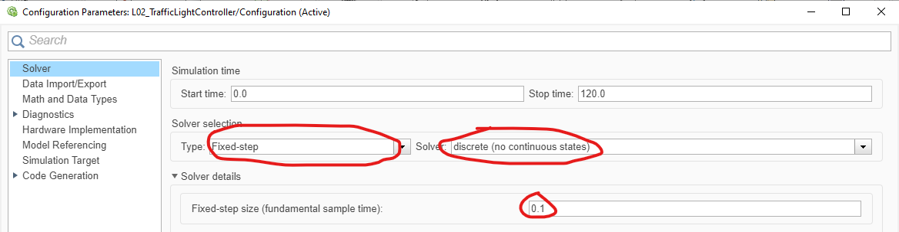
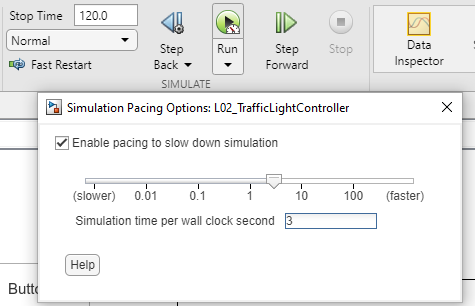

# Objective

Use Stateflow in Simulink to model and implement common time-based design
requirements:

- debouncing
- error timeouts

# Theoretical aspects

**Debouncing** means ignoring short-lived changes in an input signal, ensuring
that a Boolean condition remains true continuously for a specified duration
before taking action. If the condition becomes false before that duration
elapses, restart its timer the next time it becomes true.

- One-sided: debounce only the rising or the falling edge
- Two-sided: debounce both the rising and the falling edge

Below is the schematic for debouncing a Boolean signal.

## Debouncing with hysteresis

Debouncing can be applied to a real-valued signal by defining turn-on and
turn-off **thresholds**.

A typical operation is as follows:

- if $input > V_{on}$ continuously for a specified duration $T_{on}$, turn the output on
- if $input < V_{off}$ continuously for a specified duration $T_{off}$, turn the output off

When the two levels are different, e.g. $V_{off} < V_{on}$, the system is said
to have **hysteresis**.

In this case, when the input value is in the range $V_{off} \le input \le V_{on}$,
the output can be either on or off, depending on the previous state of the system.

# Exercises

1. Design an FSM in Stateflow to implement a User Switch Logic module, according to the following requirements:

    1. **Inputs.** There is one voltage input $V_{in}$ corresponding to the voltage measured after a button, which operates as follows:

       - when the button is not pressed, voltage is $V_{in} > 4.5\,\mathrm{V}$
       - when the button is pressed, voltage is $V_{in} < 0.5\,\mathrm{V}$

    2. **Outputs.** There are three Boolean outputs: `ShortPress`, `LongPress`, `StuckError`

    3. The voltage input shall be debounced as follows:

       - when the voltage $V_{in} < 0.5\,\mathrm{V}$ continuously for at least $T_{on}$, the button shall be considered pressed
       - when the voltage $V_{in} > 4.5\,\mathrm{V}$ continuously for at least $T_{off}$, the button shall be considered released
       - otherwise the button state will not change
       - the initial state is released

    4. After debouncing, measure the duration of the button press and activate the outputs as follows.

    5. When the button is pressed for up to $T_{long}$, the system shall set the output `ShortPress = TRUE` for duration $T_{out}$.

       The output shall be set on the de-pressing of the button.

    5. When the button is pressed for longer than $T_{long}$, the system shall set the output `LongPress = TRUE` for duration $T_{out}$.
       The output shall be set as soon as the $T_{long}$ delay has elapsed.

    5. When the button is pressed for longer than $T_{error}$, the system shall set the output `StuckError = TRUE`, and set the other outputs to False.

       The output shall be set as soon as the $T_{error}$ delay has elapsed. The output is maintained until the button is de-pressed.

    8. Make all durations configurable using parameters from the MATLAB workspace.

       Default values are $T_{on} = 200\,\mathrm{ms}$,
       $T_{off} = 100\,\mathrm{ms}$, $T_{long} = 3\,\mathrm{s}$,
       $T_{out} = 20\,\mathrm{ms}$, and $T_{error} = 25\,\mathrm{s}$.

2. Test your design using appropriate input signals and inspect the outputs:

   - short presses, long presses, and a press held until the stuck error occurs;
   - low- and high-voltage glitches shorter than the corresponding debounce times;
   - interrupted debounce intervals, to check that timing restarts;
   - voltage in the range $0.5\,\mathrm{V} \le V_{in} \le 4.5\,\mathrm{V}$,
     to check that the debounced state is retained;
   - press durations just below, at, and just above $T_{long}$ and $T_{error}$,
     measured using the debounced state;
   - pulse widths of $T_{out}$ and release after a long press or stuck error;
   - repeated presses, to check that timers and outputs reset correctly.

# General requirements

- **Timing:** In Model Settings, choose solver type **Fixed-step**, solver
  **discrete (no continuous states)**, and fixed-step size **0.01 seconds** (or another appropriate value).

  The screenshot below illustrates the solver settings; use **0.01**, not the
  0.1 shown in the image.

  

- Use **Simulation Pacing** for interactive tests. Pacing changes the viewing
  speed. Use Scope timestamps to measure timing.

  

- Put all inputs and outputs into a Scope block, for visualization and analysis
- For interactive testing, connect a **Constant** block to $V_{in}$ and bind a
  Dashboard [**Push Button**](https://www.mathworks.com/help/simulink/slref/pushbutton.html)
  to its value. Set the Constant value to 5, choose **Momentary** behavior, and
  set **On Value** to 0 (5 V released, 0 V pressed).
  Use scripted input signals for reproducible glitches and exact boundary tests.
- You can attach "Lamp" blocks from the Dashboard group to easily see the outputs

