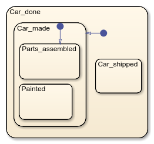
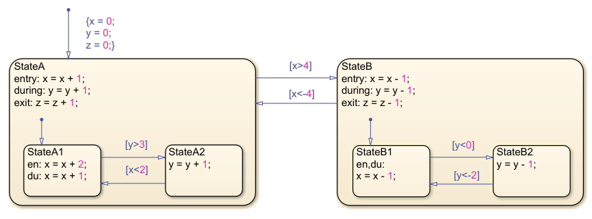
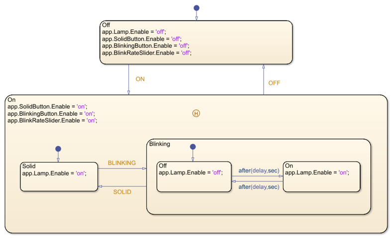
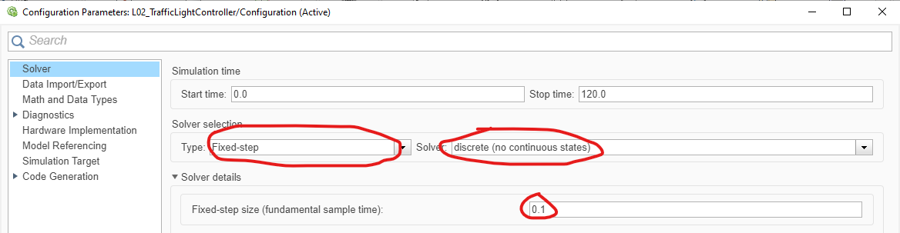
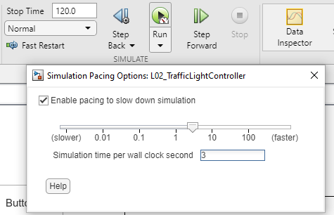

# Objective

Use Stateflow in Simulink to design and test a hierarchical FSM for an LED
animation controller. Use superstates and history junctions.

# Theoretical aspects

## Substates and superstates

An FSM can have a multi-level hierarchy composed of **substates** inside
**superstates**.

In this lab, use **exclusive (OR) decomposition**: when a
superstate is active, only one of its immediate substates is active.

Within a substates of a state, one of the must be the default.
A default transition inside the superstate selects the initial substate,
as in the following image[^1].

[^1]: All images are from the Matlab documentation

The check of transitions is done in **top-down order**:

1. First check all transitions of the super-state

   If a transition is found valid, it is executed, all the substates are exited without any further checks, and the target state is entered.

2. Only if no super-state transition is valid, go down one level and check transitions leaving from substates.

A detailed steb-by-step workflow for execution of a chart in Stateflow is provided in Matlab documentation:

[Link: Execution of a Stateflow chart](https://www.mathworks.com/help/stateflow/ug/chart-during-actions.html)

[Link: Workflow of evaluating transitions](https://www.mathworks.com/help/stateflow/ug/evaluate-transitions.html)

## History junctions and timing

On ordinary entry to an exclusive superstate, the default transition selects
its initial substate.

When a **history junction sign** is a present in a super-state, then
when entering the state execution goes to **the last active substate when it last exited the state**, instead of the default substate. This is useful for restoring the previous substate.

On the first entry,
when there is no recorded history, the default transition is used.

It is also possible for a transition to explicitly cross the
border of a superstate and target one of its substates.
However, this is not recommended, as it breaks the encapsulation of the superstate and makes the design more difficult to understand and maintain.

Using history restores active states, and that's all.
The subtates are considered to be re-entered, so their `entry` actions run again, and any temporal conditions such as `after(0.2,sec)` restart from zero.

See [MathWorks, Resume Prior Substate Activity Using History Junctions](https://www.mathworks.com/help/stateflow/ref/historyjunction.html)
and [after](https://www.mathworks.com/help/stateflow/ref/after.html).

## Implementing a ramp-up or ramp-down

A useful pattern in Simulink is to implement a linear ramp-up or ramp-down of a value, i.e., a gradual increase or decrease over a specified time interval.

For example, imagine we want to ramp up a value from 0 to 100 in 3 seconds. If the sample time is $T_s = 0.01\,\mathrm{s}$,
then we need to go from 0 to 100 in 300 time steps. The increment per sample is therefore

$$\Delta x = \frac{100}{300} = \frac{1}{3}.$$

We can use a local variable which is incremented by $\Delta x$ at each sample, for example in the `during` action of a state, or with a self-transition. The value must be clamped to the range 0 to 100.

To implement a ramp-down, we decrease the value instead of increasing it.

# Exercises

## 1. Implement the three animations

Design an FSM in Stateflow for a Christmas Lights Control module.

**Interface**

- Input `Command`: integer, with valid values 1, 2, and 3.
- Outputs `OUT1`, `OUT2`, `OUT3`, `OUT4`, `OUT5`: real-valued LED intensity
  values (e.g., PWM duty cycles) from 0 to 100. Zero means LED is off; 100 means maximum intensity.

Implement three animation modes, using substates for their phases:

1. **Mode 1 — Flash:** all LEDs are on at intensity 100 for 0.2 seconds, then
   off for 0.2 seconds, repeatedly. Start with the on phase.
2. **Mode 2 — Slow:** all five intensities rise linearly together from 0 to 100 in
   3 seconds, then fall to 0 in 3 seconds, repeatedly. Start at 0 and fade up.
3. **Mode 3 — Train:** only one LED is on at intensity 100 for 250 ms;
   all others are off. Advance from LED 1 through LED 5 and repeat.
   Start with LED 1.

First test each mode separately with `Command` held at 1, 2, or 3.
Assign all five outputs explicitly so a previous mode cannot leave an LED on.

## 2. Add command selection and automatic cycling

Implement the following command behavior:

- `Command = 0`: run Flash, Slow, and Train in that order, for 10 seconds each;
  repeat indefinitely. Start with Flash.
- `Command = 1`, `2`, or `3`: run only the corresponding mode indefinitely.
- On a change of `Command` value, start the newly selected
  behavior from its initial phase. Entering automatic operation starts a new
  10-second Flash interval. Holding a command must not repeatedly restart it.
- Assume the command always has a valid value.

**Design hint:** keep the 10-second mode timer in a super-state, while the animation phases are in substates.

Save and test this version before adding the pause behavior.

## 3. Add overheating protection and history

- Add a new Boolean input `OVERHEATING`. When it becomes TRUE, immediately leave normal operation and set all five outputs to zero. When it becomes FALSE, resume the previous mode and phase, but after at least 15 seconds of pause.

**Design hint:** Group the normal-operation states inside a `Running` superstate and add a `Paused` state.
Overheating transitions from the high-level `Running` to `Paused` states and back. Use history junctions to restore the previous mode and phase when coming back.

## 5. Optional extension: preserve exact animation progress

Extend the design so that pause/resume also preserves the **remaining time**
of Flash and Train phases and of the automatic 10-second mode interval.
For example, a pause 100 ms into a Train phase must leave 150 ms of that phase
on resumption, rather than restarting a full 250 ms.

Use explicitly stored elapsed-time or sample counters that advance only during
normal operation. Define when each counter resets, and check the order of
incrementing and testing to avoid one-step errors. History alone is not enough.
Verify this extension with pauses partway through animation phases.

# General requirements

- **Timing:** choose solver type **Fixed-step**, solver **discrete (no continuous
  states)**, and fixed-step size **0.01 seconds**.

  Use **0.01**, not the 0.1 shown in the screenshot.

  

- Use **Simulation Pacing** for interactive tests, in order to have simulation time slightly faster than normal time

  

- Put all inputs and outputs into a Scope block, for visualization and analysis
- Attach a nice input widget such as a **Knob** or **Slider** from the Dashboard group for the `Command` input. Set its range to 0–3 and its step size to 1.
- You can attach "Lamp" blocks from the Dashboard group to easily see the outputs (unfortunately, they do not show intensity, only on/off)

