## VI. Composition of State Machines

### Composition of state machines

- How to combine multiple smaller FSMs into a bigger one?

- What problems arise?

- Two types of compositions:

  1. **Spatial** composition: how are the components connected?
  2. **Temporal** composition: how do the components react in time?

### Spatial composition

**Spatial** composition = how are two components connected, how does the information flow between the components

  - **Side-by-side** composition = no common inputs/outputs, no shared data

  - **Cascade** composition = Outputs of one FSM are inputs to another one

  - **Feedback** composition = (Some) outputs of an FSM are inputs to the same FSM, or to some other component situated upstream

### Side-by-side composition

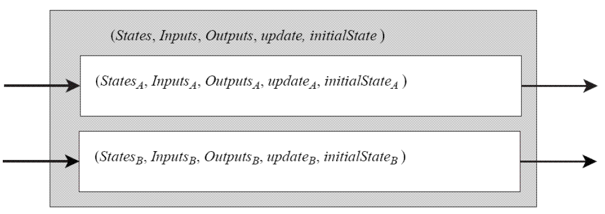{width=80%}

### Cascade composition

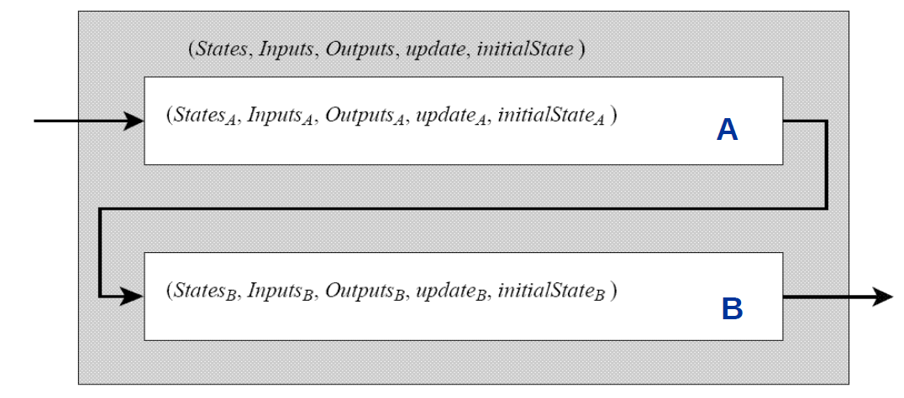{width=80%}

- Outputs of FSM A are inputs to FSM B

### Feedback composition

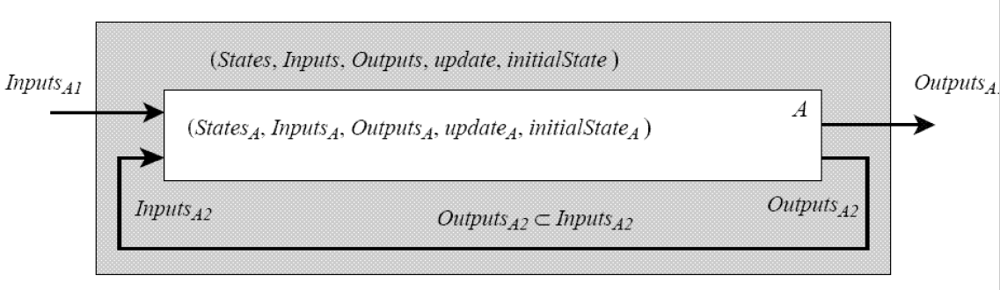{width=80%}

- Some outputs of the FSM are coming back as inputs

### Temporal composition

**Temporal** composition = when do two components react?

  - **Sequential vs Parallel** composition:

    - **Sequential** = the two FSMs do not work at the same time
    - **Parallel** = the two FSMs work at the same time

  - **Asynchronous vs Synchronous** composition = only for parallel composition

    - **Synchronous** = the FSMs react at the same time, i.e. are driven by the same clock

    - **Asynchronous** = the FSMs react at independent times

### Sequential composition

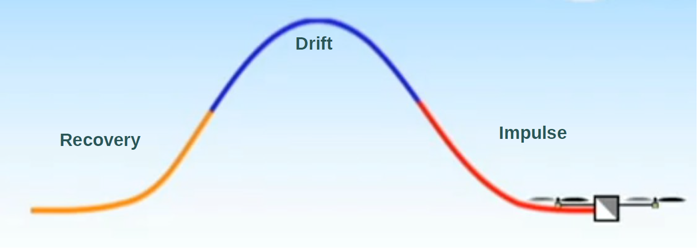{width=80%}

- [https://www.youtube.com/watch?v=iD3QgGpzzIM](https://www.youtube.com/watch?v=iD3QgGpzzIM)

- The drone has three modes of operation, working **in sequence**

### Parallel composition

{width=50%}

- The two FSMs can be represented as a single **equivalent model** FSM

- When do the transitions in these FSMs take place?

  - Synchronous: simultaneously
  - Asynchronous: independently

### Synchronous composition

- Consider the two FSMs on the left (A and B)

- The equivalent model is on the right

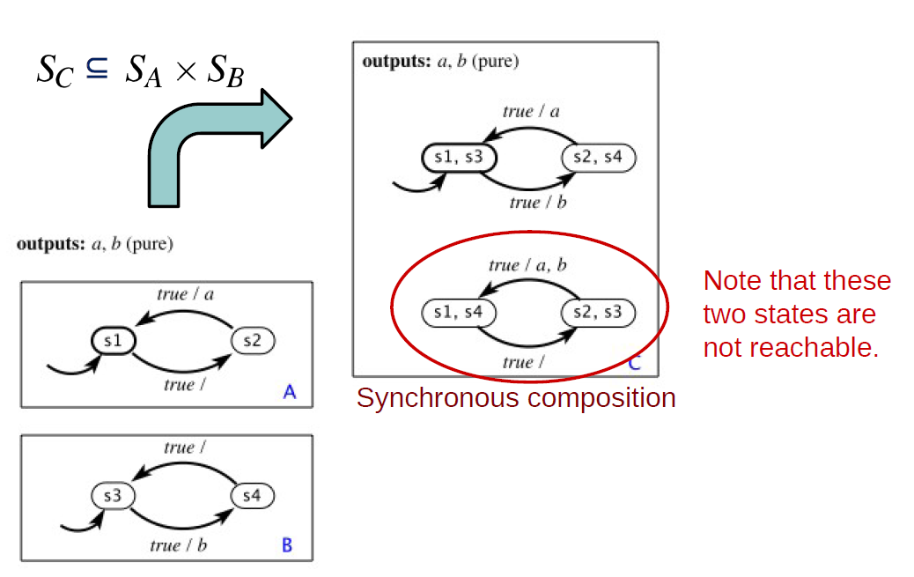{width=60%}

### Synchronous composition

Redraw here

### Synchronous composition

- In the equivalent model:

  - States = combination of states of the two FSMs
  - Transition = transition in FSM A and FSM B, happening simultaneously.

  - There might exist unreachable states in the equivalent model (states that will never be reached)

### Asynchronous composition

Draw here

### Asynchronous composition

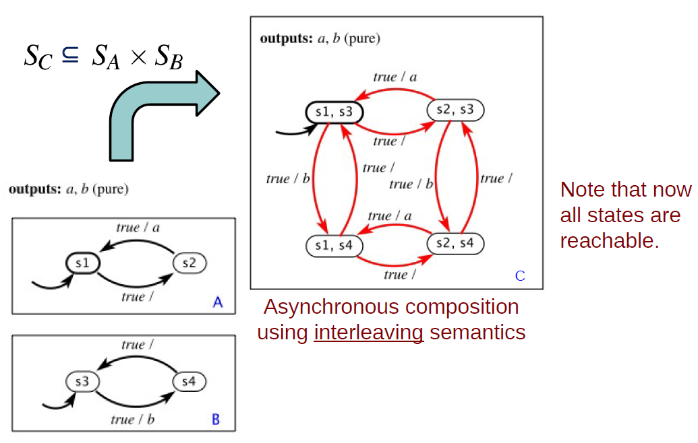{width=90%}

### Asynchronous composition

- In the equivalent model:

  - States = combination of states of the two FSMs
  - Transitions in the two FSMs can take place at irregular
and independent (not synchronized) times

  - All states are reachable, in general
    - because one model can be much faster than the other

### Asynchronous composition

Flavors of asynchronous composition

- How are simultaneous transitions handled?
- **Interleaving** semantics:

  - simultaneous transition in models A and B is not allowed (we may
have either a transition in model A, or a transition in B)
  - i.e. transition in one model happens first, then transition in the other model B
takes place (after some time delay)

- **Simultaneous** semantics:

  - simultaneous transition in models A and B is allowed
  - for example, we may have either

    - transition only in model A
    - transition only in model B
    - Simultaneous transition in models A and B

### Example

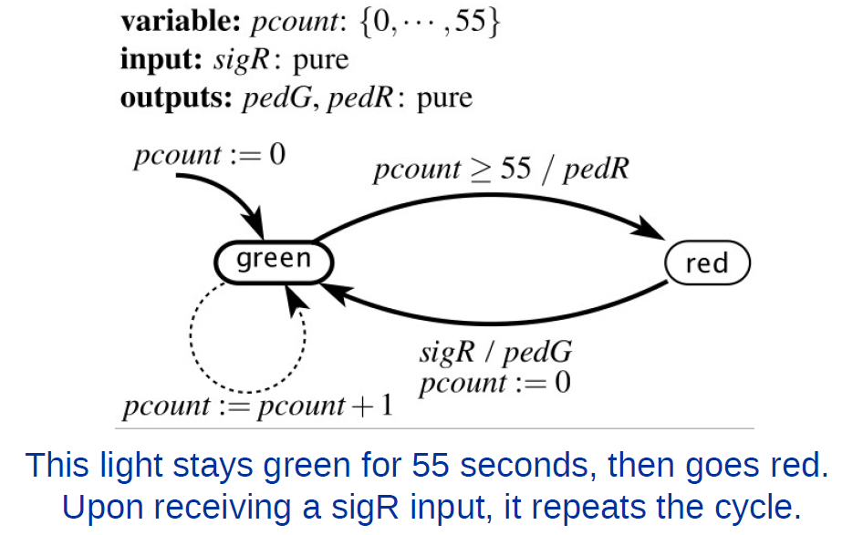{width=90%}

### Example

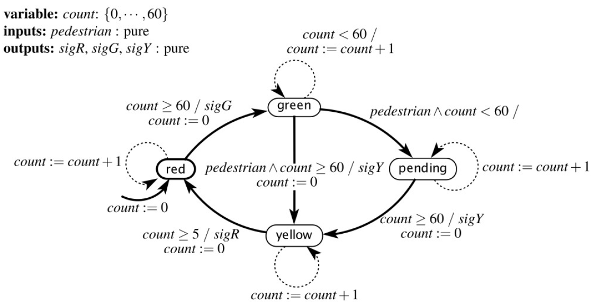{width=90%}

### Example

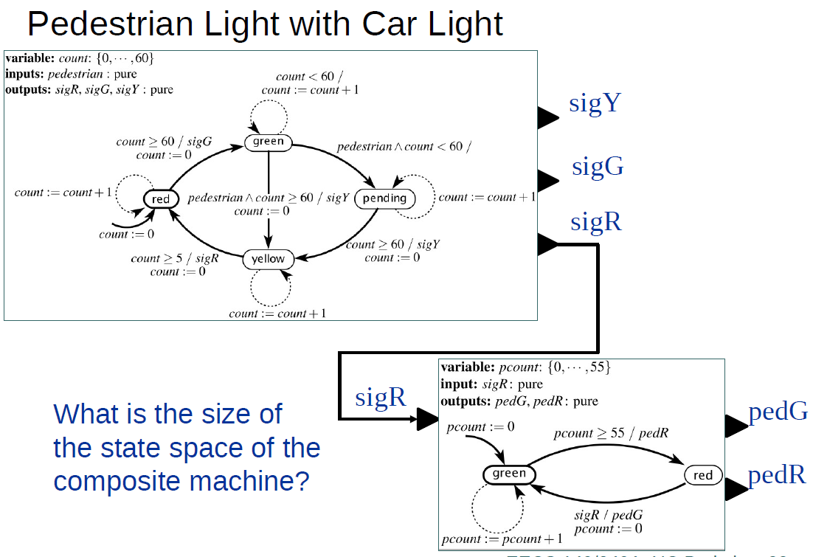{width=90%}

### Example

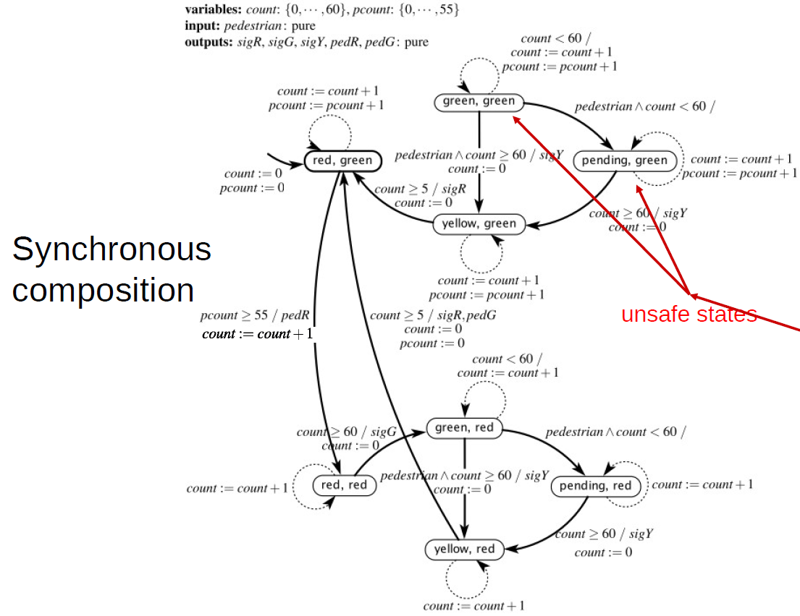{width=90%}

### Example

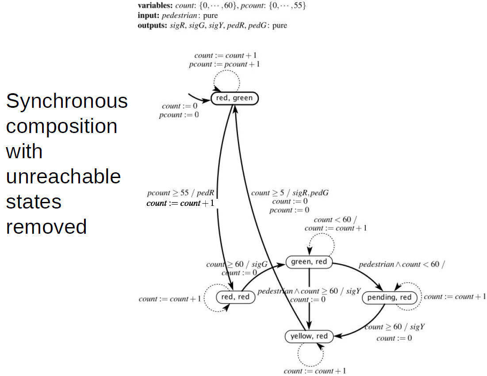{width=90%}

